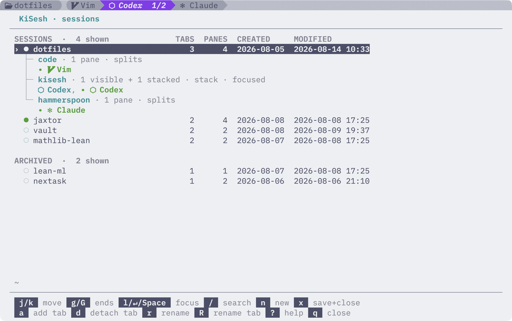

<picture>
  <source media="(prefers-color-scheme: dark)" srcset="docs/kisesh-logo-dark.svg">
  <source media="(prefers-color-scheme: light)" srcset="docs/kisesh-logo-light.svg">
  
</picture>

[](https://sw.kovidgoyal.net/kitty/)
[](https://www.python.org/)
[](https://www.apple.com/macos/)
[](LICENSE)

KiSesh is an extension for the

[Kitty](https://sw.kovidgoyal.net/kitty/) terminal emulator providing lightweight session redesign.
It uses Kitty's native tabs, panes, overlays, watchers, and remote control, with **no** terminal multiplexer.

<picture>
  <source media="(prefers-color-scheme: dark)" srcset="docs/kisesh-dark.png">
  <source media="(prefers-color-scheme: light)" srcset="docs/kisesh-light.png">
  
</picture>

Above is a screenshot of the KiSesh session panel (press `Alt+s` to open it).
This is a Kitty overlay panel for managing KiSesh sessions.

> [!NOTE]
> KiSesh does **not** preserve the in-memory state of running processes.


### Features

Below is the list of features KiSesh provides.

- Session recovery (see `apps.toml` for configuring)
  - bring back history up to 2000 lines for each pane
  - rerun **recognized** last running command
  - prefill **unrecognized** commands and arguments without executing them
  - auto resume `claude`, `codex`, and `pi` sessions (if enabled)
- `● live`, `○ saved`, and `○ archived` session states
- Autosave when change in: layout, terminal context, or command execution
- Attach or detach a tab to/from a session

### Process safety

Ordinary autosaves use at most two workers per Kitty process, with only one
worker per session. Events received while a saver is busy are coalesced rather
than spawning more workers or timer threads. Pane-close captures use the same
queue, and quit flushes queued captures before saving the remaining live layout.

Background CLI saves and save-and-close operations have a 25-second deadline.
The ordinary autosave supervisor allows 30 seconds for payload transfer and
execution, then terminates its isolated worker group and reaps the child before
reusing the slot. A 60-second native quit watchdog cancels a stalled quit rather
than claiming that persistence succeeded.

Pending events are acknowledged only after a durable-save receipt. Failed
captures remain queued for a later event or quit attempt; prior snapshots stay
available. Close-capture buffering is limited to 64 panes, with each normal and
alternate-screen capture bounded to 1,048,576 characters and last-command output
to 65,536 characters. Queue overflow and unacknowledged saves are reported to Kitty's stderr.
Force-quitting Kitty can still lose captures that have not reached storage.

A closed pane that no longer matches the saved layout is preserved separately
under `~/.local/share/kisesh/recovered-panes/<session-uuid>/`. These private JSON
files retain the capture for manual recovery without replacing a surviving
pane's history or blocking subsequent saves. Identical retries reuse the same
file; recovery files are kept until explicitly removed (or session data is purged).

Process regressions can be tested with `just test-processes`. These tests use
mock Kitty objects, temporary data, sanitized environments, and disposable child
process groups; they do not connect to or reconfigure a running Kitty instance.

## Install

**Requirements**

- [Kitty](https://sw.kovidgoyal.net/kitty/) >= 0.47.2
- Nerd Font

```sh
curl -LsSf https://github.com/TolgaOk/kisesh/releases/latest/download/install.sh | sh
```

Using `uv`:

```sh
uv tool install --python 3.11 \
  https://github.com/TolgaOk/kisesh/releases/latest/download/kisesh.tar.gz &&
  kisesh enable
```

Restart `Kitty` after either installation method, then press `Alt+S` to open the
KiSesh session manager.

> [!IMPORTANT]
>
> To enable agent session recovery add hooks with:
>
> ```sh
> kisesh agents enable
> ```
>
> Inspect the hooks with `kisesh agents status`; remove them with `kisesh agents disable`.

Manage Kisesh from the same CLI:

```sh
kisesh enable
kisesh disable
kisesh uninstall
```

`enable/disable` enables or disable KiSesh.
`uninstall` removes KiSesh (`--purge` for removing the session data).

## Configuration

Session data is stored locally in `~/.local/share/kisesh/` by default.

```toml
version = 2

[defaults]
restore = "prefill"
label = "App"
icon = ""

[agents.claude]
match = ["claude", "claude-*"]
restore = "resume"
adapter = "claude"
label = "Claude"
icon = "✻"

[apps.nvim]
match = ["nvim", "nvim-*"]
restore = "captured"
label = "Neovim"
icon = ""

# ...
```
